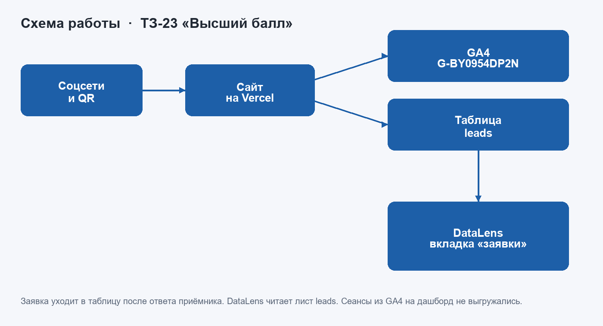
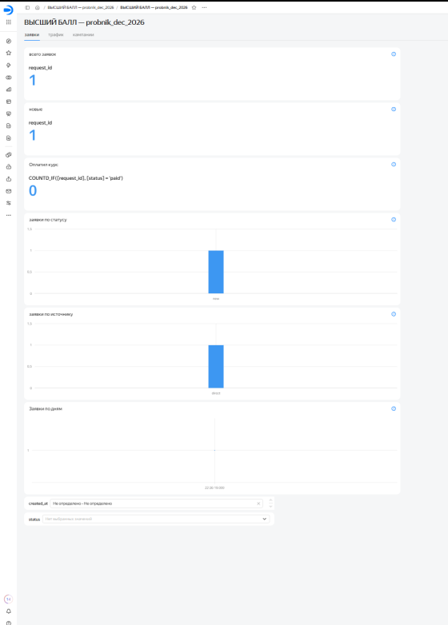
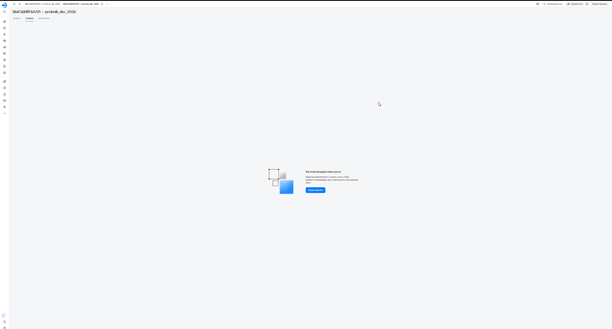
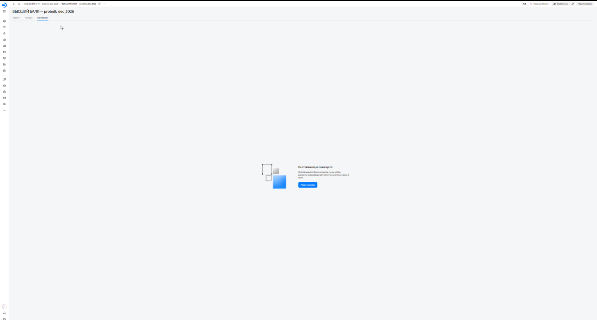

# Высший балл — сайт и запись на пробный ЕГЭ

Курсовая работа по дисциплине ОП.03 «Информационные технологии», ТЗ № 23/2026.
Исполнитель: Товстенко Оскар Александрович, группа 9/2-РПО-25/1.

Сайт центра «Высший балл»: посетитель приходит по ссылке с меткой источника, заявка на пробный ЕГЭ пишется в Google Таблицу вместе с предметом, классом и UTM.



## Ссылки

| Что | Ссылка |
|---|---|
| Сайт | https://tz-23-podgotovka-ege-vysshiy-ball-kappa.vercel.app |
| Таблица заявок | https://docs.google.com/spreadsheets/d/1tlOdfSNFo36c2zEj1Qg70MWZ8MDQBaklNhQpNucmM_Q |
| Дашборд DataLens | https://datalens.ru/nzgpr4exf5as6-vysshiy-ball-probnik-dec-2026 |
| Instagram и Reel с автоответом | не созданы |
| ВКонтакте · Telegram · YouTube | не созданы |
| Описание работы | [docs/opisanie.md](docs/opisanie.md) |
| Презентация к защите | [presentation/zashchita.pptx](presentation/zashchita.pptx) |

Ресурс GA4: `G-BY0954DP2N`. Доступ Viewer к ресурсу GA4 выдан: почта заказчика не передавалась.

## Что сделано

| Часть | Результат |
|---|---|
| Сайт | 10 страниц и `404.html`, статический HTML, опубликован на Vercel. Оценка Lighthouse не снималась |
| GA4 | 6 автоматических и 14 своих событий, 7 пользовательских параметров. Ключевые: `generate_lead`, `contact_click`, `messenger_click` |
| UTM | 12 ссылок в реестре, QR и афиша. Публикаций в соцсетях нет |
| Заявки | форма → Apps Script → лист `leads`. Контрольная строка с метками U-01 (`instagram` / `social` / `probnik_dec_2026` / `bio`) записана 10 ноября 2026, статус `new` |
| Instagram | ManyChat не подключался |
| Отчёты | Дашборд DataLens собран: вкладка «заявки» считает лист `leads`. «трафик» и «кампании» пустые, выгрузки сеансов из GA4 нет. Reports и Explore не заполнены. Числа в записке не выдуманы |

## Технологии

HTML, CSS, JavaScript · Google Analytics 4 · Google Таблицы и Apps Script · Yandex DataLens · GitHub и Vercel.
Сайт создан с помощью Cursor, модель Grok 4.7. Запросы — в [docs/prompts.md](docs/prompts.md).

## Дашборд

Вкладка «заявки» считает строки листа `leads`. Вкладки «трафик» и «кампании» пустые: сеансы из GA4 на дашборд не выгружались.







## Структура

```text
index.html …         страницы сайта
js/analytics.js      все события GA4
apps-script/Code.gs  приёмник заявок
docs/                описание, реестр UTM, события, записка, схема
screens/datalens/    три вкладки дашборда
presentation/        презентация к защите
```

## Итог

Не получилось: посты в соцсетях, короткие ссылки, ManyChat, снимки DebugView и отчётов GA4. Событие `purchase` остаётся ключевым, потому что Analytics не даёт снять эту метку.
Нейросеть использовалась для: страницы, стили, события, форма, калькулятор, диагностика, приёмник заявок, реестр ссылок, PDF, QR и дашборд DataLens.
