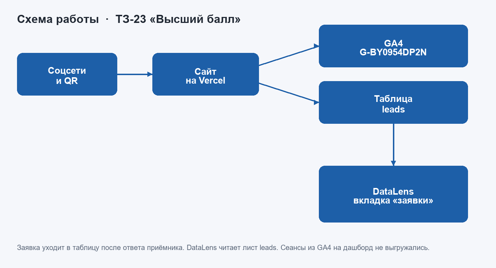
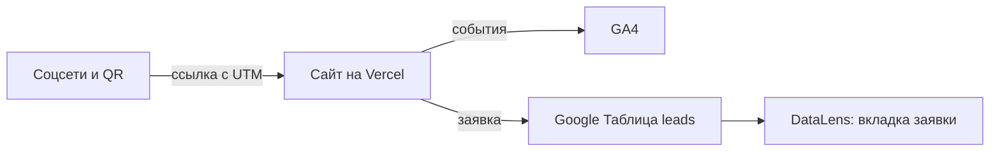
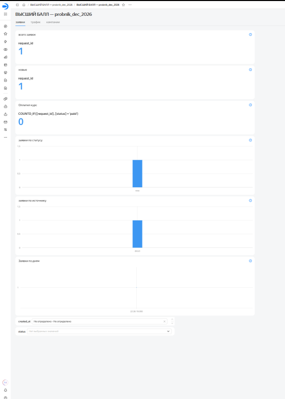
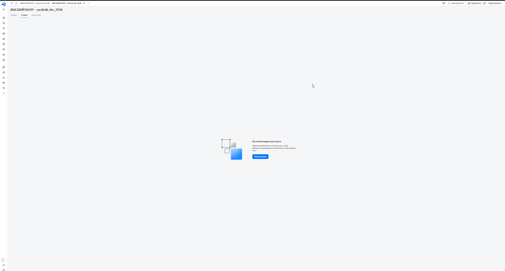
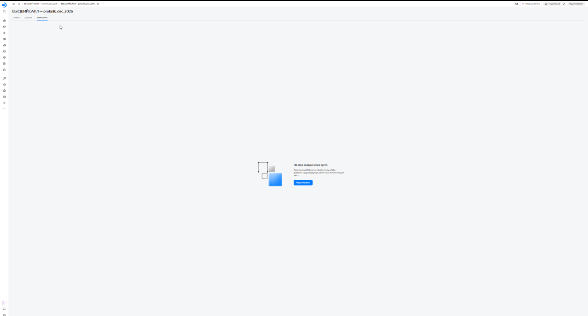

# Описание работы · ТЗ № 23/2026 · «Высший балл»

**Исполнитель:** Товстенко Оскар Александрович, группа 9/2-РПО-25/1
**Сайт:** https://tz-23-podgotovka-ege-vysshiy-ball-kappa.vercel.app
**Период проверок:** кадры DebugView и отчётов GA4 ещё не сняты. Три вкладки DataLens лежат в `screens/datalens/`.

## 1. Задача заказчика

Центр «Высший балл» готовит школьников 9–11 классов к ОГЭ и ЕГЭ с 2017 года. Сейчас занимаются 470 учеников, работают 18 преподавателей по 6 предметам. После бесплатного пробного ЕГЭ курс покупает примерно каждый третий участник. Регистрация шла через переписку и Google Форму, поэтому центр не видел, из какого канала пришёл человек, который потом остался учиться.

Пробный ЕГЭ назначен на 13 декабря 2026 года, регистрация открыта с 1 ноября. Нужен сайт с предметами, преподавателями, результатами, мини-диагностикой и формой. Каждая заявка должна попадать в одну таблицу с предметом, классом и источником.

## 2. Схема работы

Посетитель переходит из соцсети или по QR-коду по ссылке с UTM-метками. Сайт отправляет события в GA4, а заявку — в Google Таблицу через Apps Script. DataLens читает лист `leads` на вкладке «заявки». Сеансы из GA4 на дашборд не выгружались.

Схема на Mermaid

## 3. Сайт

Сайт из 10 страниц и `404.html` создан в Cursor и лежит в репозитории статическими файлами. На каждой странице, включая страницу ошибки, стоит тег `G-BY0954DP2N`. Сайт опубликован на Vercel и открывается по адресу выше.

Кадры главной страницы на телефоне и отчёт Lighthouse ещё не сняты.

## 4. Аналитика GA4

Ресурс называется «ВЫСШИЙ БАЛЛ — сайт». Часовой пояс Москва, валюта RUB, расширенная статистика включена. Своих событий 14, автоматических 6. Ключевые события: `generate_lead`, `contact_click`, `messenger_click`. Зарегистрированы 7 параметров с областью «Событие»: `button_name`, `page_section`, `subject`, `score`, `lead_role`, `lead_subject`, `messenger`.

Событие `generate_lead` отправляется только после ответа приёмника `{"ok": true}`. Имя, телефон и почта в GA4 не передаются. Кадры DebugView ещё не сняты.

## 5. UTM-ссылки и соцсети

В реестре `docs/utm.csv` 12 ссылок: Instagram, ВКонтакте, Telegram, YouTube, два блогера и QR на афише. QR полной ссылки U-12 лежит в `docs/qr-u-12.png`, афиша — в `docs/afisha.pdf`.

Аккаунты соцсетей, короткие ссылки и публикации не заводились. Ники блогеров в реестре оставлены как `blogger_1` и `blogger_2`. Кадров перехода по публикациям нет, потому что публикаций нет.

## 6. Заявки

Форма на странице контактов не отправляется без согласия. Для роли «ученик» нужен отдельный флажок «Мне есть 18 лет». Телефон приводится к виду `+7` и 10 цифр. Приёмник проверяет поля, не принимает повторный `request_id` и записывает строку на лист `leads` со статусом `new`.

Таблица: https://docs.google.com/spreadsheets/d/1tlOdfSNFo36c2zEj1Qg70MWZ8MDQBaklNhQpNucmM_Q

Контрольная заявка отправлена с сайта 10 ноября 2026 и записана на лист `leads` со статусом `new`. Метки совпадают со ссылкой U-01: `instagram`, `social`, `probnik_dec_2026`, `bio`. Имя, телефон и почта в этот файл не копировались. Имени «Приёмка ТЗ-23/2026» в строке нет. Более ранняя строка с `utm_medium` = `cpc` и кампанией `{{campaign.id}}` к реестру не относится.

## 7. Автоответы в Instagram

Reel и ManyChat не подключались. Две ветки автоответа из задания не сделаны.

## 8. Отчёты и дашборд

Отчёты GA4 и воронка Explore не собраны. Числа в `docs/report.md` не заполнены: выдуманные показатели в записку не ставились.

Дашборд «ВЫСШИЙ БАЛЛ — probnik_dec_2026»: https://datalens.ru/nzgpr4exf5as6-vysshiy-ball-probnik-dec-2026

Вкладка «заявки» считает строки листа `leads`: всего заявок, новые, оплатил курс, заявки по статусу, по источнику и по дням. Рядом стоят селекторы периода `created_at` и статуса. Вкладки «трафик» и «кампании» пустые, потому что выгрузки сеансов из GA4 нет.

## 9. Что получил бизнес

| Было | Стало |
|---|---|
| регистрация через переписку и Google Форму | форма на сайте пишет заявку в лист `leads` |
| источник записи не сохранялся | у заявки есть поля UTM, если человек пришёл по размеченной ссылке |
| события сайта не считались | на всех страницах стоит ресурс `G-BY0954DP2N` |
| сравнение каналов вручную | дашборд считает заявки из листа `leads`; сеансов GA4 на нём нет, каналы по трафику сравнить нельзя |

Рекомендацию, какой канал вести дальше, давать рано: отчётов GA4 ещё нет, а на дашборде нет сеансов.

## 10. Итог

Не получилось: посты в соцсетях, короткие ссылки, ManyChat, снимки DebugView и отчётов GA4.
ИИ использовался для: страницы, стили, события, форма, калькулятор, диагностика, приёмник заявок, реестр ссылок, PDF, QR и дашборд DataLens.
